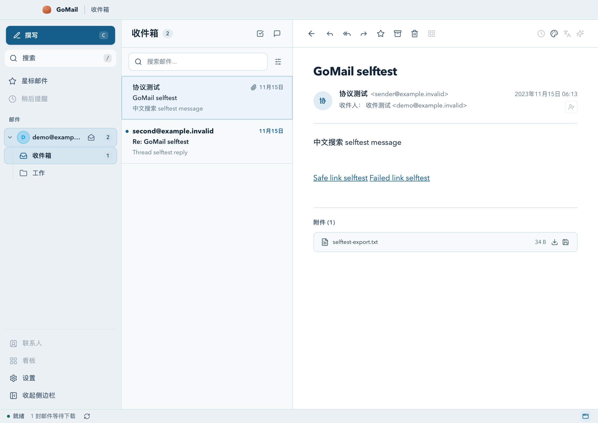
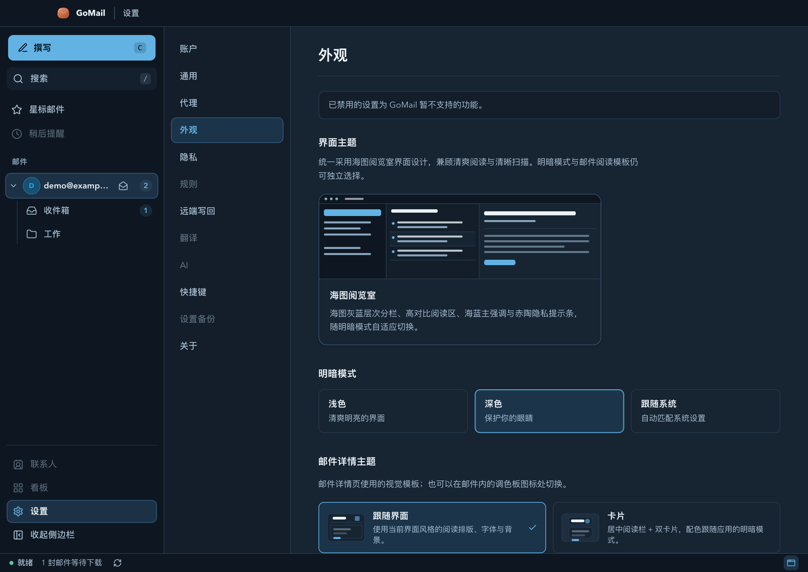
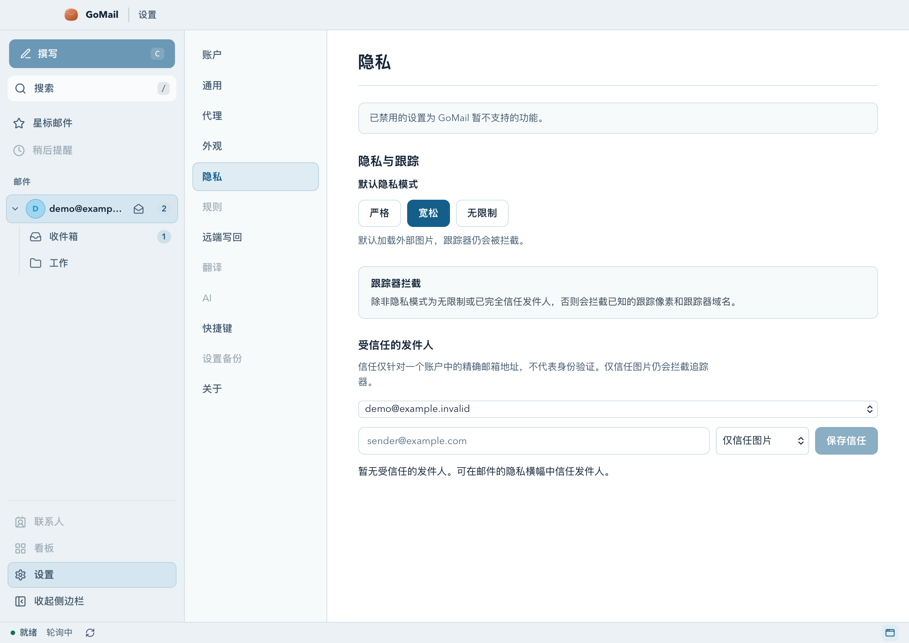
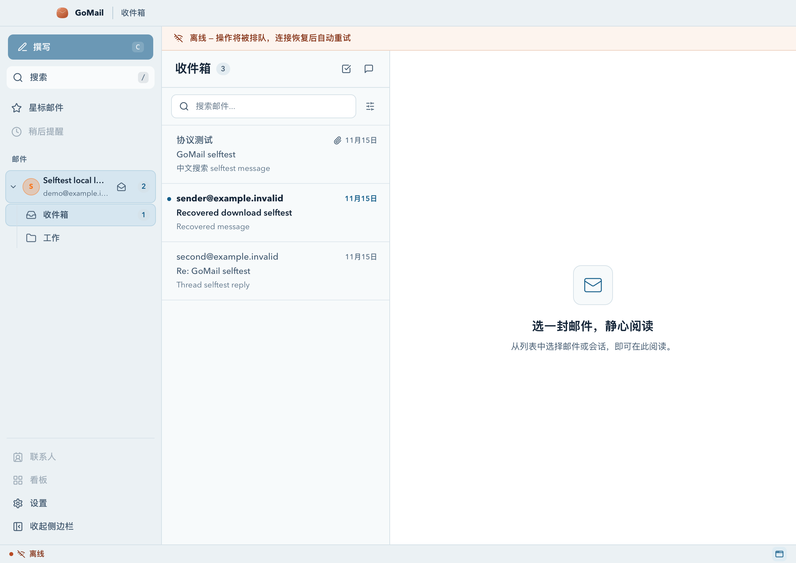

<div align="center">


# GoMail

**A calm, local-first desktop email client built with Go, MyGO WebView, and pure-Go SQLite.**

Keep your mail archive, FTS5 full-text index, HTML privacy sanitizer, encrypted drafts, durable Outbox, and OAuth/protocol credentials **100% on your machine**—with zero cloud servers or browser webmail tab clutter.

[](https://github.com/duanyongcheng/gomail/releases/latest)
[](https://github.com/duanyongcheng/gomail/actions/workflows/ci.yml)
[](https://duanyongcheng.github.io/gomail/)
[](https://go.dev/)
[-1b6e56)](https://pkg.go.dev/modernc.org/sqlite)
[](https://react.dev/)

**English** · **[简体中文](README.zh-CN.md)** &nbsp;|&nbsp; **[Official Homepage](https://duanyongcheng.github.io/gomail/)** · **[Download Releases](https://github.com/duanyongcheng/gomail/releases/latest)** · **[Architecture](docs/architecture.md)** · **[Design System](DESIGN.md)** · **[Issues](https://github.com/duanyongcheng/gomail/issues)**

</div>

<br />

<picture>
  <source media="(prefers-color-scheme: dark)" srcset="docs/images/harbor-dark.png" />
  <source media="(prefers-color-scheme: light)" srcset="docs/images/harbor-light.png" />
  
</picture>

<table>
  <tr>
    <td width="33.3%">
      
      <sub><b>Harbor Chartroom UI</b> — Unified light/dark/system shell decoupled from 9 message reading templates.</sub>
    </td>
    <td width="33.3%">
      
      <sub><b>Go Privacy Shield</b> — Strict HTML/CSS sanitization, tracker blocking, and per-account sender trust.</sub>
    </td>
    <td width="33.3%">
      
      <sub><b>Offline-First Operation</b> — Local cache, FTS5 search, and drafts stay usable while remote writes queue safely.</sub>
    </td>
  </tr>
</table>

---

## Download & Install

Prebuilt cross-platform installers are published on **[GitHub Releases](https://github.com/duanyongcheng/gomail/releases/latest)** with verified `SHA256SUMS.txt` checksums and Ed25519-signed `bsdiff` incremental auto-updates:

| Platform | Architecture | Package Format | Auto-Update & Verification |
| --- | --- | --- | --- |
| **macOS** | Apple Silicon (`arm64`) / Intel (`amd64`) | `.dmg` (ad-hoc signed `GoMail.app`) | Signed `bsdiff` deltas + `SHA256SUMS.txt` |
| **Windows** | `x64` (`amd64`) / `ARM64` | NSIS `Setup.exe` | Signed `bsdiff` deltas + `SHA256SUMS.txt` |
| **Linux** | `x64` (`amd64`) / `ARM64` | `.deb`, `.tar.gz`, `install.sh` | Signed `bsdiff` deltas / GitHub Releases check + `SHA256SUMS.txt` |

> **Interactive Preview:** Visit **[duanyongcheng.github.io/gomail](https://duanyongcheng.github.io/gomail/)** to try an interactive Harbor Chartroom workspace preview in your browser and auto-select the installer for your OS.

---

## Why GoMail?

| Pillar | How GoMail Works Locally |
| --- | --- |
| **Zero Cloud Middleware** | Connects directly from your computer to Gmail, IMAP/SMTP, POP3, and Microsoft endpoints. No GoMail account, no remote indexing server, and no credential upload. |
| **Pure-Go SQLite + FTS5** | Built on `modernc.org/sqlite` (`CGO_ENABLED=0`) with WAL mode, `synchronous=FULL` writer durability (`1` writer + `4` read-only connections), instant FTS5 search, and RFC 2047 display-name decoding. |
| **Go-Side Privacy Sanitizer** | Untrusted HTML and CSS are parsed and sanitized in Go (`Strict`, `LoadOnce`, `TrustedSender`, `Off`) before reaching WebView, blocking tracking pixels/domains and serving inline CID images strictly via `gomail-attachment://`. |
| **OS Keyring AES-256-GCM** | OAuth tokens, passwords, signatures, local drafts, Outbox snapshots, proxy settings, and in-app Google OAuth credentials are sealed with a 32-byte master DEK in your OS keyring (`dev.bary.gomail`) using context-bound AAD (`GOMAIL\x00\x01`). |
| **Durable Outbox Safety** | Outgoing mail is encrypted to disk before transmit. If a network drop leaves delivery in an **unknown outcome**, GoMail holds the item for explicit **Check Sent** reconciliation rather than risking duplicate sends. |
| **Harbor Chartroom Comfort** | Bilingual Chinese/English (`zh` / `en`) interface with zero external font/icon CDNs, three stepped coastal luminance planes (`light` / `dark` / `system`), and **9 independent reading templates**. |

---

## Supported Mail Providers & Capabilities

### Mail Protocols

- **Gmail (Google OAuth 2.0 PKCE):** Multi-account support (`gmail.modify` + `openid email profile`) with in-app encrypted Client ID/Secret configuration, resumable full-mailbox backfill and paginated History sync, isolated download failure retry queue (up to 50 MiB), durable FIFO remote-write queue, encrypted local drafts with explicit Gmail cloud-copy upload/check/update/import/delete and cloud-linked sending, account-scoped conversations, custom server label CRUD, per-account sender trust, encrypted signatures, and safe same-mailbox reconnection. Permanent delete / empty-trash is disabled under `gmail.modify`.
- **IMAP & SMTP:** Verified TLS/STARTTLS, custom endpoint CA PEM trust, and global/direct/per-account HTTP CONNECT or SOCKS5 proxy routing. Selected IMAP folders maintain durable `UIDVALIDITY`-aware checkpoints, queued flags/moves/trash, server folder CRUD, and scheduler-owned IDLE (first selected folder; additional selected folders poll). SMTP sends through the encrypted Outbox with frozen `Bcc` envelope recipients and `Bcc`-free MIME headers.
- **POP3:** Verified TLS/STLS, bounded `UIDL`/`RETR` parsing, `UIDL` deduplication checkpoints, deliberately disabled remote flag/folder mutations, and optional SMTP sending.
- **Microsoft / Outlook & Experimental Graph:** Native public-client OAuth 2.0 PKCE with validated tenant/audience policy, separate Graph/Exchange resource grants, and independent IMAP/SMTP XOAUTH2. Experimental Microsoft Graph supports recursive folder discovery, resumable delta/raw MIME sync, durable writes, and `sendMail`.

### Desktop Integration & Hardening

- **Window & Instance Control:** Native close-to-background vs. quit-on-close (`Settings → General → Quit app when window is closed`), single-instance window restoration, locked-down WebView navigation, and validated external `http(s)` link opening.
- **Safe Attachments:** Native **Download** (system Downloads folder) and **Save As** dialog with collision-safe filenames and symlink-contained cache reads.
- **Signed Auto-Updates:** Ed25519-verified update manifests and `bsdiff` delta patches (for up to 3 previous signed releases), with read-only GitHub Releases fallback (**Settings → About** and macOS menu **Check for Updates…**).

### Guarded / Upcoming Capabilities

Views and settings tabs not yet backed by local runtime services remain visibly guarded with truthful unavailable notices: advanced search filters, local labels, contacts, Kanban board, snooze, rules, templates, opt-in AI assistant, translation, WebDAV/file backup, desktop notifications/tray/autostart, hidden startup, and the in-app diagnostic log viewer.

---

## OAuth Configuration

### In-App Google OAuth Configuration (Recommended)

Configure `GOOGLE_CLIENT_ID` and optional `GOOGLE_CLIENT_SECRET` directly inside GoMail via **Settings → Accounts → Configure Google OAuth** or inside the **Add Email Account** dialog:

- Encrypted with your profile's OS keyring DEK (`dev.bary.gomail`) and stored locally in SQLite (`google_oauth_settings`, never in plaintext).
- Applies **immediately without restarting**: Google sign-in unlocks right away, matching Gmail accounts restore automatically, secret-only updates hot-rebuild providers, and switching to a different `Client ID` preserves local mail/drafts while marking existing Gmail accounts for reconnection.
- Precedence: **In-app saved configuration > Process environment variables (`.env` in dev)**. Clearing in-app credentials immediately falls back to runtime environment variables (if set).

### Runtime Environment Variables (Development Only)

Copy `.env.example` to `.env` if you want local runtime defaults during `bun run dev`:

```dotenv
GOOGLE_CLIENT_ID=your-desktop-client-id.apps.googleusercontent.com
GOOGLE_CLIENT_SECRET=your-desktop-client-secret
```

- `GOOGLE_CLIENT_ID` and `GOOGLE_CLIENT_SECRET` are **never embedded** into packaged binaries (`bun run build`, `./scripts/build-local.sh`, or GitHub Releases).
- Microsoft setup accepts a native public-client ID, validated tenant/audience, and separate resource grants directly in the account form (no client secret).

> **Security:** Never commit `.env`, OAuth credentials, tokens, profiles, or mailbox data to Git. `.env` and `.env.*` are gitignored; `.env.example` contains placeholders only.

---

## Development & Building from Source

### Prerequisites

- **Go** `1.27.3`
- **Bun**
- **Node.js** `22+` (for Vite / Vitest)
- Platform WebView runtime (macOS WebKit / Linux WebKitGTK / Windows WebView2)

### Quick Start in Development

```sh
git clone https://github.com/duanyongcheng/gomail.git
cd gomail
bun install
bun run generate
bun run dev
```

An empty profile opens cleanly and stays running; credential restoration on startup never contacts the network. Once the UI loads the profile's sync mode preference, configured accounts start syncing unless set to `manual`.

### Local macOS App Bundle

```sh
bun run build:local
# Or run directly from any directory:
./scripts/build-local.sh
```

Verifies `go`, `bun`, `node`, and `codesign`, installs dependencies with `--frozen-lockfile`, regenerates MyGO bindings, type-checks and builds the frontend, packages a `CGO_ENABLED=0` ad-hoc signed bundle at `build/darwin-<arch>/GoMail.app`, and verifies it with `codesign --verify --deep --strict`:

```sh
open "build/darwin-arm64/GoMail.app"
```

### Cross-Platform Builds & GitHub Workflows

Pass MyGO build flags via `bun run build` (optionally overriding `GOMAIL_VERSION`):

```sh
GOMAIL_VERSION=0.3.0 bun run build -skip-dmg -skip-notarize
```

GitHub Actions workflows under `.github/workflows/`:

- **[ci.yml](.github/workflows/ci.yml):** Runs the full `bun run check` quality gate and verifies committed `src/mygo.ts` bindings on pushes/PRs to `master`.
- **[release.yml](.github/workflows/release.yml):** Builds macOS (`.dmg`), Windows (NSIS `Setup.exe`), and Linux (`.deb`, `.tar.gz`, `install.sh`) installers across `amd64` and `arm64`, signs update archives, `bsdiff` deltas, and `update-<target>.json` manifests with `MYGO_UPDATER_PRIVATE_KEY`, verifies `SHA256SUMS.txt`, and publishes GitHub Releases on `v*` tags.
- **[pages.yml](.github/workflows/pages.yml):** Publishes the standalone bilingual product homepage in [`site/`](site/index.html) to GitHub Pages (`https://duanyongcheng.github.io/gomail/`).

---

## Profiles, Storage & Testing

### Profile Resolution & Layout

Application identifier & OS keyring service: `dev.bary.gomail` (`GoMail`). Profile directory precedence:

1. `GOMAIL_PROFILE_DIR` environment variable (relative paths resolve beside the executable).
2. First line of `gomail-profile.txt` beside the executable.
3. `gomail-profile/` directory beside the executable.
4. Platform user-data directory (`GoMail`).

Each profile contains `profile-id` (persistent frontend preference namespace), `gomail.sqlite` (WAL + `synchronous=FULL` writer, 4 read-only connections, 15s busy timeout), `attachments/` (cached blobs), and `logs/gomail.log` (rotating `3 × 2 MiB` status-only JSON logs—never mail payloads or credentials).

<details>
<summary><b>SQLite Schema Summary (<code>v1</code>–<code>v33</code>)</b></summary>

All migrations are embedded in `internal/store/migrations/` and run transactionally with `PRAGMA user_version` tracking (unversioned non-empty databases are rejected):

- **Core Mail & Workspace (`v1`–`v20`):** Accounts (`gmail`, `imap`, `pop3`, `outlook`, encrypted `auth_data`, colors, sort order), folders, messages, message-folder mappings, attachments (with `content_id`), trusted senders, folder sync state, sync failures, `pending_mail_ops`, and reserved tables for upcoming local features.
- **`v21`:** FTS5 full-text search index (`message_search`).
- **`v22`:** Account-scoped Gmail backfill reconciliation table.
- **`v23`:** Persistent message download failures and retry timing.
- **`v24`:** Operation-sequence sidecar (`mail_op_sequence`) for FIFO replay and sync reconciliation.
- **`v25`:** Encrypted local compose drafts (`compose_drafts`) and deduplicated staged attachments.
- **`v26`:** Encrypted durable send Outbox (`outbox`), independent of idempotent mail mutations.
- **`v27`:** Account-scoped conversation index (`message_threads`).
- **`v28`:** Unresolved Gmail label-management write log (`gmail_label_changes`).
- **`v29`:** Encrypted account-scoped email signatures (`email_signatures`).
- **`v30`–`v31`:** Gmail cloud draft copy mappings, write intents, deletion/send lifecycle states, and Outbox links.
- **`v32`:** Provider checkpoints (`provider_checkpoints`), remote identity mappings (`provider_mappings`), and encrypted global proxy settings (`network_settings`).
- **`v33`:** Encrypted in-app Google OAuth client configuration (`google_oauth_settings`).

</details>

### Quality Gate & Isolated Desktop Selftest

```sh
bun run test
bun run check
```

`bun run check` runs `go test`/`go vet` (`CGO_ENABLED=0`), `go test -race ./internal/...` (`CGO_ENABLED=1`), `mygo vet` & `mygo generate`, TypeScript + Vitest + Vite production build, and CGO-free cross-compilation across `darwin/amd64`, `linux/amd64`, `linux/arm64`, `windows/amd64`, and `windows/arm64` (set `GOMAIL_CHECK_KEEP_ARTIFACTS=1` to keep temporary build artifacts).

To run the synthetic WebView selftest against local mock Gmail and TLS IMAP/SMTP/POP3 fixtures with an in-memory keyring and disposable profile:

```sh
CGO_ENABLED=0 go build -o /tmp/gomail-selftest .
GOMAIL_SELFTEST=1 \
GOMAIL_PROFILE_DIR=/tmp/gomail-test-profile \
GOMAIL_SELFTEST_DIR=/tmp/gomail-test-results \
/tmp/gomail-selftest
```

---

## Documentation & Credits

- **[Official Homepage (`site/`)](site/index.html)** — Bilingual interactive landing page deployed via GitHub Pages.
- **[docs/architecture.md](docs/architecture.md)** — System architecture, `internal/` package map, cryptography, sanitizer, sync/outbox pipelines, and updater internals.
- **[PRODUCT.md](PRODUCT.md)** — Product principles, target users, implemented scope, and roadmap.
- **[DESIGN.md](DESIGN.md)** — Harbor Chartroom design tokens, typography, layout rules, and component specifications.

Built with **[MyGO](https://github.com/egoist/mygo)**, **[modernc.org/sqlite](https://pkg.go.dev/modernc.org/sqlite)**, **[go-imap](https://github.com/emersion/go-imap)** / **[go-smtp](https://github.com/emersion/go-smtp)** / **[go-message](https://github.com/emersion/go-message)**, **[React 19](https://react.dev/)**, **[Vite](https://vite.dev/)**, and **[TipTap](https://tiptap.dev/)**.
