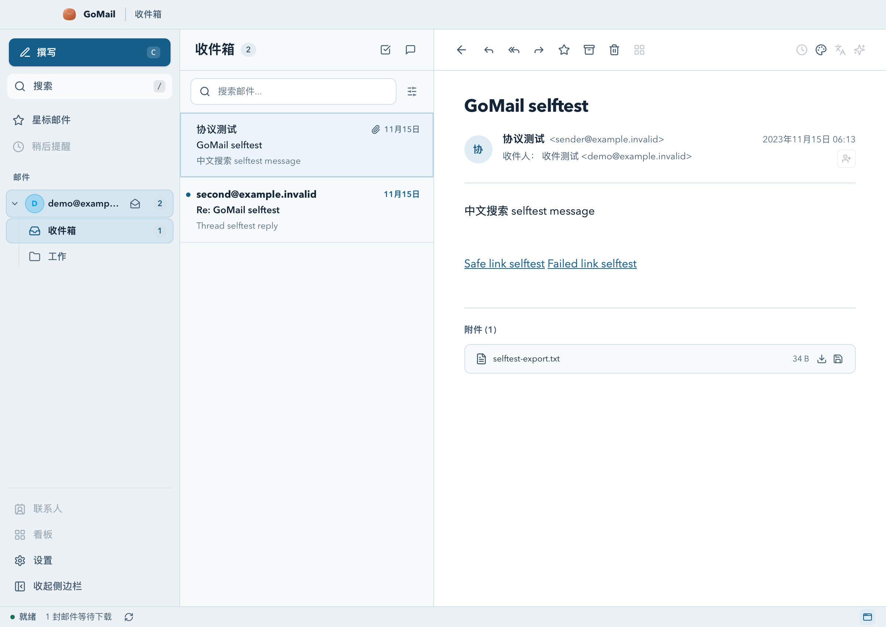
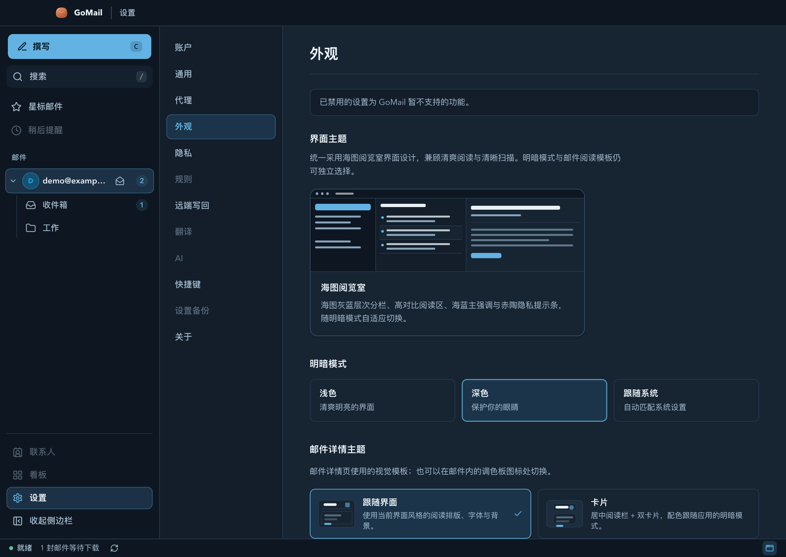
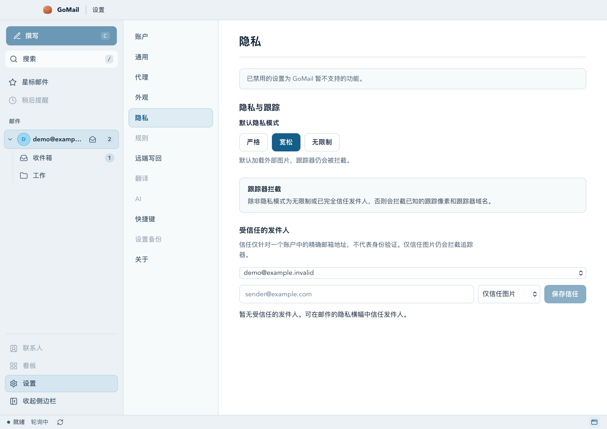
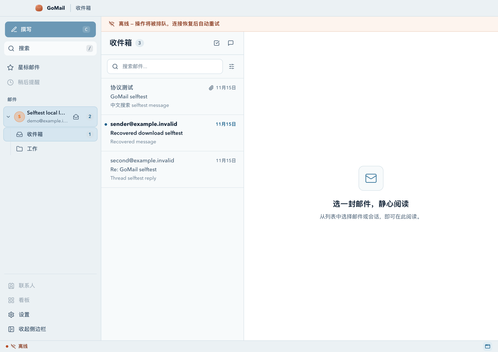

<div align="center">


# GoMail

**基于 Go、MyGO WebView 与纯 Go SQLite 打造的安静、本地优先跨平台桌面邮件客户端。**

将你的邮件归档、FTS5 全文检索索引、HTML 隐私净室清洗、加密草稿、可靠发件箱（Durable Outbox）与邮箱凭据 **100% 留在自己的电脑里**——零云端中转服务器，告别杂乱的网页邮箱标签页。

[](https://github.com/duanyongcheng/gomail/releases/latest)
[](https://github.com/duanyongcheng/gomail/actions/workflows/ci.yml)
[](https://duanyongcheng.github.io/gomail/)
[](https://go.dev/)
[-1b6e56)](https://pkg.go.dev/modernc.org/sqlite)
[](https://react.dev/)

**[English](README.md)** · **简体中文** &nbsp;|&nbsp; **[软件主页](https://duanyongcheng.github.io/gomail/)** · **[安装包下载](https://github.com/duanyongcheng/gomail/releases/latest)** · **[架构文档](docs/architecture.md)** · **[设计规范](DESIGN.md)** · **[问题反馈](https://github.com/duanyongcheng/gomail/issues)**

</div>

<br />

<picture>
  <source media="(prefers-color-scheme: dark)" srcset="docs/images/harbor-dark.png" />
  <source media="(prefers-color-scheme: light)" srcset="docs/images/harbor-light.png" />
  
</picture>

<table>
  <tr>
    <td width="33.3%">
      
      <sub><b>Harbor Chartroom 设计系统</b> — 统一的浅色/深色/跟随系统外壳，与 9 套独立邮件阅读模板解耦。</sub>
    </td>
    <td width="33.3%">
      
      <sub><b>Go 净室隐私拦截</b> — 进入 WebView 前清洗 HTML/CSS、拦截追踪像素，支持按账户管理受信任发件人。</sub>
    </td>
    <td width="33.3%">
      
      <sub><b>离线优先体验</b> — 断网照常阅读、全文检索与编辑加密草稿，远端修改清晰排队并在恢复后自动重放。</sub>
    </td>
  </tr>
</table>

---

## 下载与安装

前往 **[GitHub Releases](https://github.com/duanyongcheng/gomail/releases/latest)** 获取预构建的跨平台原生安装包。所有正式发布版本均附带 `SHA256SUMS.txt` 校验清单，并支持基于 Ed25519 签名校验的 `bsdiff` 增量自动更新：

| 操作系统 | 支持架构 | 安装包格式 | 自动更新与完整性校验 |
| --- | --- | --- | --- |
| **macOS** | Apple Silicon (`arm64`) / Intel (`amd64`) | `.dmg`（内置 ad-hoc 签名 `GoMail.app`） | Ed25519 签名 `bsdiff` 增量更新 + `SHA256SUMS.txt` |
| **Windows** | `x64` (`amd64`) / `ARM64` | NSIS `Setup.exe` 安装程序 | Ed25519 签名 `bsdiff` 增量更新 + `SHA256SUMS.txt` |
| **Linux** | `x64` (`amd64`) / `ARM64` | `.deb`、`.tar.gz`、`install.sh` | 签名增量更新 / GitHub Releases 检查 + `SHA256SUMS.txt` |

> **在线交互体验：** 访问官方主页 **[duanyongcheng.github.io/gomail](https://duanyongcheng.github.io/gomail/)**，可直接在浏览器中交互体验 Harbor Chartroom 界面、切换阅读模板与模拟离线状态，并自动识别当前系统下载对应安装包。

---

## 核心设计理念

| 核心支柱 | 本地优先工程实现 |
| --- | --- |
| **零云端中转服务器** | 客户端从你的电脑直连 Gmail、IMAP/SMTP、POP3 与 Microsoft 源站服务器；无需注册第三方账号，不上传任何邮箱密码或令牌。 |
| **纯 Go SQLite + FTS5** | 采用无 CGO 依赖的 `modernc.org/sqlite`（`CGO_ENABLED=0`），启用 WAL 日志与 `synchronous=FULL` 写连接持久性（1 写 + 4 只读连接池），内置毫秒级 FTS5 全文搜索与 RFC 2047 姓名解码。 |
| **Go 层 HTML 隐私净室** | 所有外来邮件 HTML/CSS 在进入 WebView 之前均在 Go 层完成白名单清洗（`Strict`、`LoadOnce`、`TrustedSender`、`Off` 四档），拦截追踪像素与外链样式泄漏，内嵌 CID 图片仅经受限的 `gomail-attachment://` 协议读取。 |
| **系统钥匙串 AES-256-GCM** | 邮箱令牌、协议密码、签名、本地草稿、发件箱快照、全局代理与应用内 Google OAuth 配置均由操作系统钥匙串（`dev.bary.gomail`）中的 32 字节主密钥（DEK）配合绑定用途/记录 ID 的 AAD 信封（`GOMAIL\x00\x01`）加密；钥匙串锁定时绝不降级为明文。 |
| **发件箱未知结果保护** | 待发邮件先加密落盘再投递；一旦网络中断导致投递结果未明（Unknown Outcome），系统将诚实挂起并引导通过 **核验已发送（Check Sent）** 确认，绝不盲目自动重发造成重复邮件。 |
| **海岸海图室阅读体验** | 中英双语实时切换，零外部字体/图标 CDN 请求；遵循三阶海岸亮度层次（海雾外框 → 粉海列表 → 纯白/深海阅读纸面），并提供 **9 套独立邮件详情阅读模板**。 |

---

## 支持的邮箱协议与桌面能力

### 邮箱服务商与协议

- **Gmail（Google OAuth 2.0 PKCE）：** 支持多账户并行（`gmail.modify` + `openid email profile`）、应用内加密保存自定义 Client ID/Secret（免重启热生效）、全量断点续传回填与分页 History 增量同步、单封失败隔离重试队列（上限 50 MiB）、持久化 FIFO 远端写回队列、本地加密草稿与显式 Gmail 云端草稿上传/检查/更新/导入/删除及联动发送、按账户会话聚合、服务端自定义标签增删改查、受信任发件人与安全重连。在 `gmail.modify` 权限边界下禁用永久彻底删除与清空废纸篓。
- **IMAP 与 SMTP：** 强制校验 TLS/STARTTLS 证书链，支持自定义根证书（CA PEM）以及全局/直连/分账户独立的 HTTP CONNECT 或 SOCKS5 代理。已选 IMAP 文件夹维护感知 `UIDVALIDITY` 的持久化检查点、离线标志/移动/删除队列、服务端文件夹管理，并由调度器托管首文件夹 IDLE 实时推送；SMTP 发信冻结信封 `Bcc` 收件人并确保生成的 MIME 头不含 `Bcc` 泄漏。
- **POP3：** 强制校验 TLS/STLS，具备有界 `UIDL`/`RETR` 解析与 `UIDL` 去重检查点，刻意禁用不可靠的远端状态修改，可搭配可选 SMTP 发信。
- **Microsoft / Outlook 与实验性 Graph：** 原生公共客户端 OAuth 2.0 PKCE（严格校验租户与受众策略），分离 Graph 与 Exchange 授权范围，支持独立 IMAP/SMTP XOAUTH2；实验性 Microsoft Graph 支持递归文件夹发现、断点 Delta/原始 MIME 同步、持久化写回与 `sendMail`。

### 桌面端加固与更新

- **窗口生命周期与单实例：** 支持关闭窗口退至后台或直接退出（`设置 → 通用`）、单实例唤醒聚焦、WebView 导航锁死防护，所有邮件外链均经协议校验后调用系统默认浏览器打开。
- **安全附件导出：** 支持一键保存至系统下载目录或唤起原生「另存为」对话框，内置重名防覆盖编号与缓存目录符号链接越界防护。
- **签名增量自动更新：** 支持校验 Ed25519 签名的更新清单与 `bsdiff` 增量补丁（覆盖最近 3 个签名版本），开发版或包管理器安装自动回退至只读 GitHub Releases 版本检查（`设置 → 关于` 及 macOS 菜单 `检查更新…`）。

### 路线图开发中的受保护视图

尚未接入本地运行时服务的视图与设置页均在界面中保留清晰的不可用说明，绝不伪造空操作：高级搜索筛选、本地标签、联系人通讯录、看板视图、稍后提醒（Snooze）、邮件规则、邮件模板、可选 AI 助手、全文翻译、WebDAV/文件加密备份、系统通知/托盘/开机自启、静默启动以及应用内诊断日志查看器。

---

## OAuth 凭据配置

### 应用内配置 Google OAuth（推荐）

无需编写配置文件，直接在客户端 **设置 → 账户 → 配置 Google OAuth** 或 **添加邮箱账户** 弹窗中填写桌面端 `GOOGLE_CLIENT_ID`（及可选 `GOOGLE_CLIENT_SECRET`）：

- 凭据使用当前 Profile 在系统钥匙串（`dev.bary.gomail`）中的主密钥加密存入本地 SQLite（`google_oauth_settings`），永不明文落盘。
- **保存后免重启立即生效**：Google 登录即刻解锁，匹配账户自动恢复；更换不同 `Client ID` 时完整保留本地历史邮件与草稿，仅提示对应账户重新授权。
- 优先级：**应用内加密配置 > 进程环境变量（开发期 `.env`）**。清空应用内配置后立即平滑回退至环境变量。

### 开发期环境变量（仅限本地开发）

在 `bun run dev` 开发调试时，可将 `.env.example` 复制为 `.env`：

```dotenv
GOOGLE_CLIENT_ID=your-desktop-client-id.apps.googleusercontent.com
GOOGLE_CLIENT_SECRET=your-desktop-client-secret
```

- 任何打包流程（`bun run build`、`./scripts/build-local.sh` 或 GitHub Releases）**绝不会将 OAuth 密钥内嵌进二进制产物**。
- Microsoft 账户直接在添加账户表单中输入公共客户端 ID 与租户信息（无需 Client Secret）。

> **安全提醒：** 切勿将 `.env`、OAuth 密钥、令牌或本地邮件库提交至 Git。仓库已默认忽略 `.env` 与 `.env.*`。

---

## 本地开发与源码构建

### 环境依赖

- **Go** `1.27.3`
- **Bun**
- **Node.js** `22+`（供 Vite / Vitest 使用）
- 平台原生 WebView 运行时（macOS WebKit / Linux WebKitGTK / Windows WebView2）

### 启动开发模式

```sh
git clone https://github.com/duanyongcheng/gomail.git
cd gomail
bun install
bun run generate
bun run dev
```

全新空配置目录可直接干净启动，启动恢复阶段绝不发起任何网络请求；待前端加载同步偏好后，非 `manual` 模式的账户将按调度策略开始同步。

### 构建本地 macOS 应用包

```sh
bun run build:local
# 或在任意工作目录下直接运行脚本：
./scripts/build-local.sh
```

脚本会自动校验 `go`、`bun`、`node` 与 `codesign`，使用 `--frozen-lockfile` 安装依赖、重新生成 MyGO 绑定、完成前端类型检查与打包、编译无 CGO 依赖（`CGO_ENABLED=0`）的当前架构 `GoMail.app`，并通过 `codesign --verify --deep --strict` 严格校验签名：

```sh
open "build/darwin-arm64/GoMail.app"
```

### 跨平台构建与 GitHub Actions 工作流

可通过 `bun run build` 透传 MyGO 构建参数（可选指定 `GOMAIL_VERSION`）：

```sh
GOMAIL_VERSION=0.4.1 bun run build -skip-dmg -skip-notarize
```

仓库内置三条自动化工作流（`.github/workflows/`）：

- **[ci.yml](.github/workflows/ci.yml)：** 在 `master` 推送与 PR 时运行全量质量门禁 `bun run check`，并校验生成的 `src/mygo.ts` 是否已同步提交。
- **[release.yml](.github/workflows/release.yml)：** 在推送 `v*` 标签或手动触发时并行构建 macOS（`.dmg`）、Windows（NSIS `Setup.exe`）与 Linux（`.deb`、`.tar.gz`、`install.sh`）双架构产物，生成 Ed25519 签名更新清单、`bsdiff` 增量包与 `SHA256SUMS.txt` 并发布至 GitHub Releases。
- **[pages.yml](.github/workflows/pages.yml)：** 将独立的 [`site/`](site/index.html) 双语交互式软件主页自动部署至 GitHub Pages（`https://duanyongcheng.github.io/gomail/`）。

---

## 数据目录、存储结构与质量验证

### Profile 目录解析顺序

应用标识与系统钥匙串服务名均为 `dev.bary.gomail`（显示名称 `GoMail`）。Profile 数据目录按以下优先级解析：

1. `GOMAIL_PROFILE_DIR` 环境变量（相对路径相对于可执行文件所在目录解析）。
2. 可执行文件旁 `gomail-profile.txt` 的首行路径。
3. 可执行文件旁的 `gomail-profile/` 目录。
4. 系统标准用户数据目录（`GoMail`）。

目录内包含：`profile-id`（前端偏好持久化命名空间）、`gomail.sqlite`（1 个 WAL/`FULL` 写连接 + 4 个只读连接）、`attachments/`（附件本地缓存）以及 `logs/gomail.log`（最多保留 `3 × 2 MiB` 的状态码轮转日志，绝不记录凭据或邮件正文）。

<details>
<summary><b>SQLite 数据库迁移概览（<code>v1</code>–<code>v33</code>）</b></summary>

所有迁移脚本内嵌于 `internal/store/migrations/` 并通过 `PRAGMA user_version` 在事务中执行（拒绝覆盖未知非空数据库）：

- **核心邮件与工作台（`v1`–`v20`）：** 账户表（`gmail`、`imap`、`pop3`、`outlook`、加密 `auth_data`、颜色与排序）、文件夹、邮件、邮件-文件夹映射、带 `content_id` 的附件、受信任发件人、同步状态与错误记录、`pending_mail_ops` 及路线图预留表。
- **`v21`：** FTS5 全文搜索索引（`message_search`）。
- **`v22`：** Gmail 账户级全量回填对账表。
- **`v23`：** 单封邮件下载失败持久化与重试退避表。
- **`v24`：** 远端操作单调递增序号表（`mail_op_sequence`），保障 FIFO 重放与同步对账。
- **`v25`：** 本地加密草稿（`compose_drafts`）与去重暂存附件。
- **`v26`：** 独立加密持久化发件箱（`outbox`）。
- **`v27`：** 账户级会话线程索引（`message_threads`）。
- **`v28`：** Gmail 标签变更写回日志（`gmail_label_changes`）。
- **`v29`：** 按账户隔离的加密邮件签名（`email_signatures`）。
- **`v30`–`v31`：** Gmail 云端草稿映射、写意图、删除/发送生命周期与发件箱关联。
- **`v32`：** 协议检查点（`provider_checkpoints`）、远端标识映射（`provider_mappings`）与加密全局代理配置（`network_settings`）。
- **`v33`：** 应用内加密 Google OAuth 客户端凭据表（`google_oauth_settings`）。

</details>

### 全量质量门禁与隔离桌面自检

```sh
bun run test
bun run check
```

`bun run check` 会依次执行 `go test`/`go vet`（`CGO_ENABLED=0`）、`go test -race ./internal/...`（`CGO_ENABLED=1`）、`mygo vet` 与绑定生成校验、TypeScript 类型检查 + Vitest + Vite 构建，以及面向 `darwin/amd64`、`linux/amd64`、`linux/arm64`、`windows/amd64`、`windows/arm64` 五大目标的无 CGO 交叉编译验证。

如需在本地运行端到端合成桌面自检（使用独立应用名 `GoMail Selftest`、内存钥匙串与本地模拟 Gmail/TLS 邮件服务，不触碰真实邮箱或系统钥匙串）：

```sh
CGO_ENABLED=0 go build -o /tmp/gomail-selftest .
GOMAIL_SELFTEST=1 \
GOMAIL_PROFILE_DIR=/tmp/gomail-test-profile \
GOMAIL_SELFTEST_DIR=/tmp/gomail-test-results \
/tmp/gomail-selftest
```

---

## 相关文档与致谢

- **[软件主页源码 (`site/`)](site/index.html)** — 部署于 GitHub Pages 的中英双语交互式产品主页。
- **[docs/architecture.md](docs/architecture.md)** — 系统架构、`internal/` 包职责、加密信封、隐私清洗、同步/发件箱流水线与自动更新详解。
- **[PRODUCT.md](PRODUCT.md)** — 产品定位、目标用户、核心原则与功能路线图。
- **[DESIGN.md](DESIGN.md)** — Harbor Chartroom 视觉设计系统、色彩语义、排版与组件规范。

基于 **[MyGO](https://github.com/egoist/mygo)**、**[modernc.org/sqlite](https://pkg.go.dev/modernc.org/sqlite)**、**[go-imap](https://github.com/emersion/go-imap)** / **[go-smtp](https://github.com/emersion/go-smtp)** / **[go-message](https://github.com/emersion/go-message)**、**[React 19](https://react.dev/)**、**[Vite](https://vite.dev/)** 与 **[TipTap](https://tiptap.dev/)** 构建。
